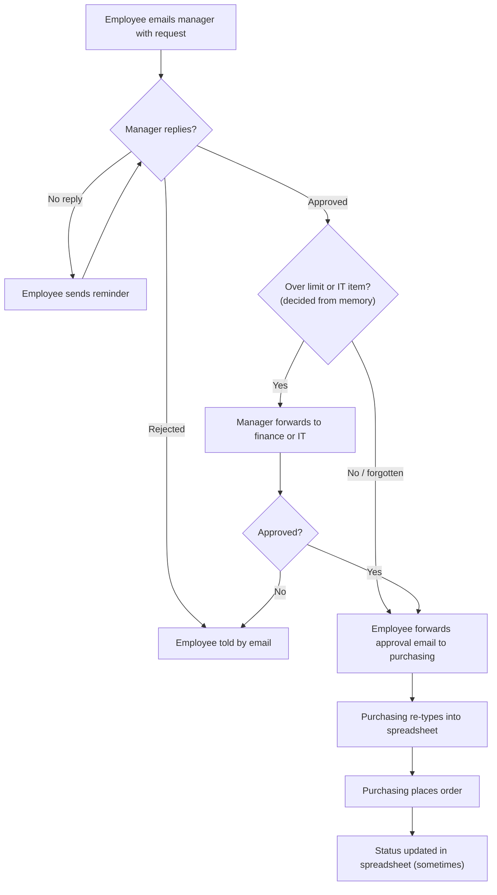
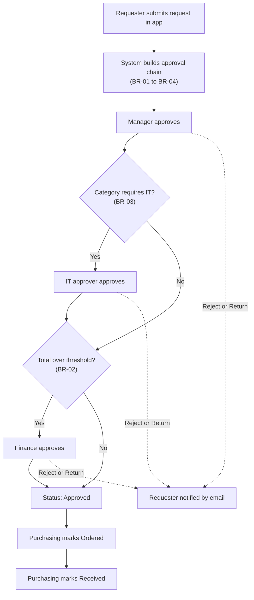
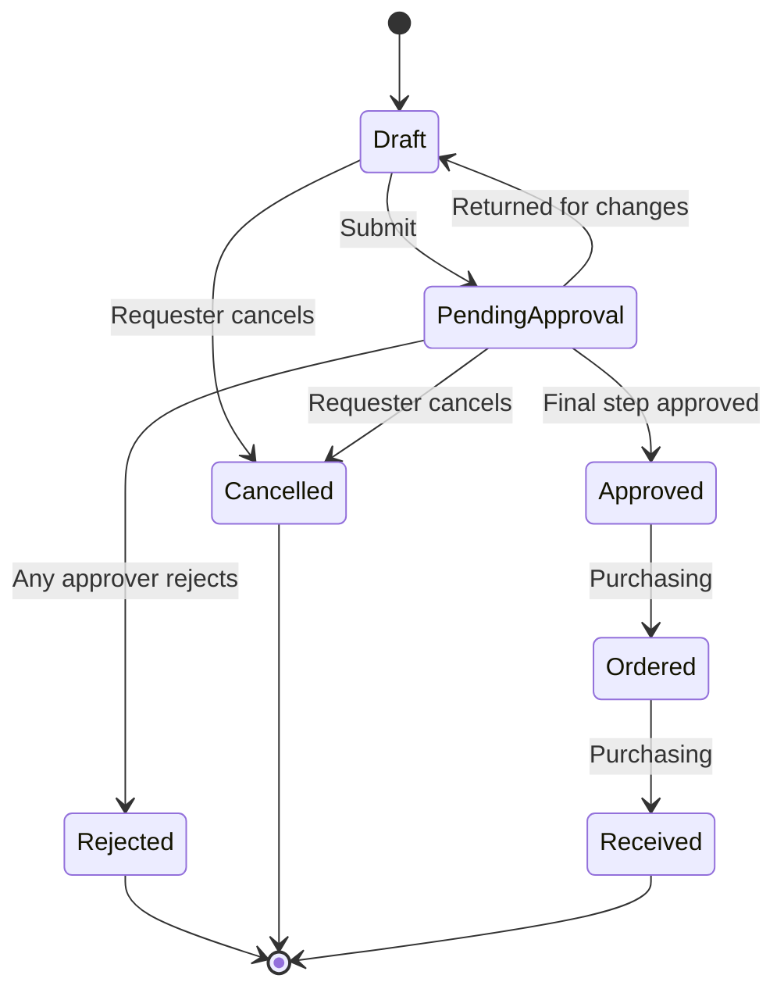

# Process Maps

## Current process (email and spreadsheet)

Problems shown: reminder loops, rules applied from memory, re-typing, no reliable status.

## Future process (Purchase Request app)

Every arrow writes a row to the audit trail and sends an email notification.

## Request lifecycle

