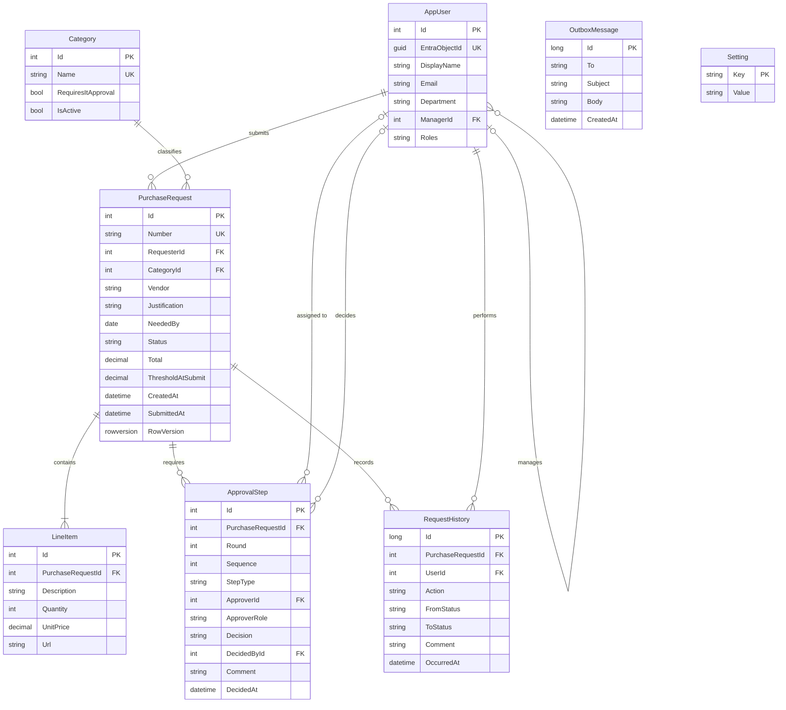

# Data Model

## Entity-relationship diagram

## Data dictionary

### AppUser
A local copy of Entra ID users, refreshed at sign-in.

| Column | Type | Rules |
|---|---|---|
| Id | int | Primary key |
| EntraObjectId | uniqueidentifier | Required, unique. Entra `oid` claim |
| DisplayName | nvarchar(200) | Required |
| Email | nvarchar(256) | Required |
| Department | nvarchar(100) | From Entra. Used by the dashboard |
| ManagerId | int, null | FK to AppUser. From Microsoft Graph, refreshed at submit (BR-01) |
| Roles | nvarchar(200) | App roles from the last sign-in, stored as `,Role1,Role2,`. Used to email IT, Finance and Purchasing |

### Category
Seeded with Office Supplies, Hardware\*, Software\*, SaaS\*, Furniture, Training, Other (\* = requires IT approval).

| Column | Type | Rules |
|---|---|---|
| Id | int | Primary key |
| Name | nvarchar(100) | Required, unique |
| RequiresItApproval | bit | Drives BR-03 |
| IsActive | bit | Inactive categories are hidden on new requests |

### PurchaseRequest
The C# class is `Request` (mapped to the `PurchaseRequests` table) because `PurchaseRequest` is the project's root namespace.

| Column | Type | Rules |
|---|---|---|
| Id | int | Primary key |
| Number | nvarchar(20) | Unique. Format `PR-YYYY-NNNN`, assigned on first save. NNNN comes from the `RequestNumbers` database sequence |
| RequesterId | int | FK to AppUser |
| CategoryId | int | FK to Category |
| Vendor | nvarchar(200) | Required |
| Justification | nvarchar(2000) | Required |
| NeededBy | date, null | Optional |
| Status | nvarchar(20) | Draft, PendingApproval, Approved, Rejected, Ordered, Received, Cancelled |
| Total | decimal(18,2) | Sum of line totals. Must be > 0 to submit |
| ThresholdAtSubmit | decimal(18,2), null | Snapshot for BR-02 |
| CreatedAt / SubmittedAt | datetime2 | UTC |
| RowVersion | rowversion | Optimistic concurrency, so two approvers cannot decide at the same moment |

### LineItem
| Column | Type | Rules |
|---|---|---|
| Id | int | Primary key |
| PurchaseRequestId | int | FK, cascade delete while Draft |
| Description | nvarchar(500) | Required |
| Quantity | int | 1 or more (check constraint) |
| UnitPrice | decimal(18,2) | 0.01 or more (check constraint) |
| Url | nvarchar(1000), null | Optional product link |

### ApprovalStep
| Column | Type | Rules |
|---|---|---|
| Id | int | Primary key |
| PurchaseRequestId | int | FK |
| Round | int | 1 for the first submit, +1 on each resubmit (BR-05) |
| Sequence | int | 1, 2, 3 in chain order within a round |
| StepType | nvarchar(20) | Manager, IT, Finance |
| ApproverId | int, null | Set for Manager steps |
| ApproverRole | nvarchar(50), null | Set for IT and Finance steps (any user in role), or Admin when there is no manager |
| Decision | nvarchar(20) | Pending, Approved, Rejected, Returned, Superseded. Concurrency token, so two approvers cannot decide the same step |
| DecidedById | int, null | FK to AppUser. Who made the decision (needed for role-based steps) |
| Comment | nvarchar(1000), null | Required for Rejected and Returned |
| DecidedAt | datetime2, null | UTC |

### RequestHistory
Append-only audit trail (NFR-03). `ApplicationDbContext` throws if code tries to update or delete a row.

| Column | Type | Rules |
|---|---|---|
| Id | bigint | Primary key |
| PurchaseRequestId | int | FK |
| UserId | int | FK. Who acted |
| Action | nvarchar(30) | Created, Submitted, Approved, Rejected, Returned, Cancelled, Ordered, Received |
| FromStatus / ToStatus | nvarchar(20) | Status before and after |
| Comment | nvarchar(1000), null | |
| OccurredAt | datetime2 | UTC |

### OutboxMessage
Emails recorded by the development email sender and shown on the Email outbox page. Replaced by real sending later.

| Column | Type | Rules |
|---|---|---|
| Id | bigint | Primary key |
| To | nvarchar(256) | Recipient address |
| Subject | nvarchar(300) | |
| Body | nvarchar(4000) | Plain text with a link to the request |
| CreatedAt | datetime2 | UTC |

### Setting
| Key | Example value | Used by |
|---|---|---|
| FinanceThreshold | 5000.00 | BR-02 |
